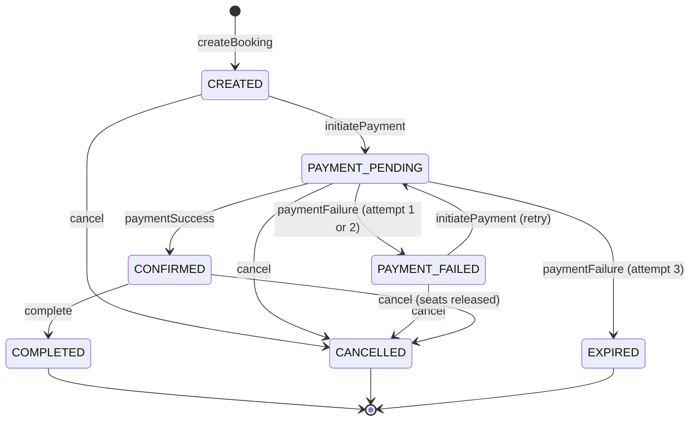

# State Transition Testing: Booking Lifecycle

**Idea:** When a system behaves differently depending on its current state, model it as states and events. Then test that every valid transition works and that invalid transitions are rejected.

Automated in: `05_Test_Automation/src/test/java/com/msrit/travel/BookingStateTransitionTest.java`

## State Diagram

## State Transition Table

Rows are current states, columns are events. A cell shows the next state, or **✖** if the event must be rejected.

| Current state ↓ / Event → | initiatePayment | paymentSuccess | paymentFailure | cancel | complete |
|---|---|---|---|---|---|
| **CREATED** | PAYMENT_PENDING | ✖ | ✖ | CANCELLED | ✖ |
| **PAYMENT_PENDING** | ✖ | CONFIRMED | PAYMENT_FAILED / EXPIRED (3rd) | CANCELLED | ✖ |
| **PAYMENT_FAILED** | PAYMENT_PENDING | ✖ | ✖ | CANCELLED | ✖ |
| **CONFIRMED** | ✖ | ✖ | ✖ | CANCELLED | COMPLETED |
| **COMPLETED** | ✖ | ✖ | ✖ | ✖ | ✖ |
| **CANCELLED** | ✖ | ✖ | ✖ | ✖ | ✖ |
| **EXPIRED** | ✖ | ✖ | ✖ | ✖ | ✖ |

## Test Cases

### Valid transitions

| TC ID | Start state | Event sequence | Expected end state |
|---|---|---|---|
| TC-ST-01 | – | createBooking | CREATED |
| TC-ST-02 | CREATED | initiatePayment | PAYMENT_PENDING |
| TC-ST-03 | PAYMENT_PENDING | paymentSuccess | CONFIRMED, seats 20 → 18 |
| TC-ST-04 | PAYMENT_PENDING | paymentFailure | PAYMENT_FAILED |
| TC-ST-05 | PAYMENT_FAILED | initiatePayment | PAYMENT_PENDING |
| TC-ST-06 | CREATED | (initiatePayment, paymentFailure) × 3 | EXPIRED |
| TC-ST-07 | CONFIRMED | complete | COMPLETED |
| TC-ST-08 | CONFIRMED | cancel | CANCELLED, seats back to 20 |
| TC-ST-13 | PAYMENT_PENDING | cancel | CANCELLED, seats unchanged at 20 |
| TC-ST-14 | PAYMENT_FAILED | cancel | CANCELLED |

### Invalid transitions (negative tests)

| TC ID | Start state | Event | Expected |
|---|---|---|---|
| TC-ST-09 | COMPLETED | cancel | Rejected (`IllegalStateException`), state stays COMPLETED |
| TC-ST-10 | CREATED | paymentSuccess | Rejected |
| TC-ST-11 | EXPIRED | initiatePayment | Rejected |
| TC-ST-12 | CANCELLED | complete | Rejected |

## Coverage

- **All 11 valid transitions** in the diagram are exercised (0-switch coverage): TC-ST-01 to TC-ST-08, TC-ST-13, TC-ST-14, and TC-ST-12, which first moves CREATED → CANCELLED.
- **4 invalid transitions** from the ✖ cells are tested, chosen from the highest-risk ones: refunding a completed trip, confirming an unpaid booking, and reviving an expired booking.
- State transition testing found **DEF-03** (TC-ST-09) and **DEF-04** (TC-ST-06, TC-ST-11).
